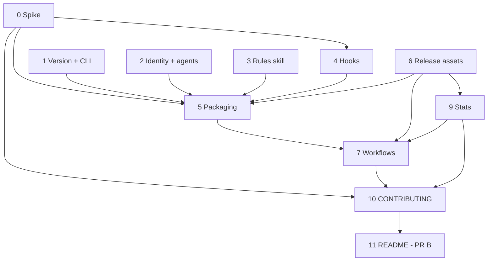

# Plan: Plugin Install and Release Workflow

**Created**: 2026-10-24 (revised after plan review the same day)
**Branch**: claude/mcp-installation-workflow-88cdb4
**Status**: approved (2026-10-24, by the user, including the step 4.1 allow-list)
**Gherkin persistence**: plan-file-only
**Spec**: [docs/specs/plugin-install-and-release-workflow.md](../docs/specs/plugin-install-and-release-workflow.md)

## Goal

Make TestStand MCP installable as a Claude Code plugin with two commands, and keep it current
automatically, the way labview-mcp works.

- Any pushed tag runs one GitHub Actions workflow. The workflow validates the tag and packages a
  self-contained win-x86 exe with the plugin hooks, rules skill and generated agents into
  `teststand-mcp.zip`.
- The workflow creates a **draft** release, reads the draft back and verifies it, and only then
  publishes it behind the fixed `releases/latest` URL.
- A PR workflow runs the same packaging and every script test without publishing.
- A Pages workflow charts downloads.
- The README leads with the new install route once the first release exists.

**Delivery in two PRs, plus one release in between.**

1. **PR A** = slices 0–10 (everything except the README).
2. **First release**: right after PR A merges, the maintainer pushes `v1.9.0`. The release run must
   be green, and AC-10 must be checked on a clean Claude Code profile.
3. **PR B** = slice 11 (the README Quickstart). It merges only after step 2. So `main` never
   advertises an install route whose archive does not exist yet.

**The development station keeps its manual registration.** This laptop has `teststand` registered
at user scope (`C:\Users\Niko\Documents\TestStandMCP\TestStandMCP.exe`). Nothing in this plan
removes, changes or shadows it:
- Spike builds run under scratch names in a scratch `.mcp.json`, never as `teststand`.
- The plugin is installed here only inside an isolated Claude Code profile, through
  `CLAUDE_CONFIG_DIR` pointing at a temp folder (confirmed in slice 0; fallback: a second Windows
  user or a VM). The AC-10/11/12 checks run there and the folder is deleted afterwards.
- The plugin and the manual registration are never active in the same profile. Doing so would give
  two server processes, two engines, and every tool and agent twice.

**Decision stances** (`knowledge/decision-defaults.md`):

- **Scope:** exactly the spec's AC-1 to AC-20. Out of scope, as in the spec: other marketplaces, the
  TestStand integration tests in CI, rewriting the old `V*` tags and hand-cut releases, code
  signing, and Linux/macOS support.
- **Replace vs. merge:** the README install section is *replaced* by the Quickstart. The manual
  route is *kept* under a secondary heading.
- **Format fidelity:** `plugin.json` is stamped by a targeted string replacement and checked byte
  for byte (UTF-8, no BOM). Hand-edited files use explicit `UTF8Encoding($false)` .NET file APIs,
  never `Set-Content -Encoding UTF8`, which writes a BOM on Windows PowerShell 5.1.
- **Integration:** PRs to `main` with auto-merge on green checks (the default). Releases come only
  from the tag workflow.

**Design choices settled by the plan review:**

- **Thin entry points over two shared modules.**
  - `build/PluginIdentity.psm1` holds the plugin name, server key and tool prefix (derived from
    `plugin.json` and `.mcp.json`, never retyped), plus agent conversion.
  - `build/ReleaseAssets.psm1` holds the asset names, digest and manifest read/write, and tag
    parsing.
  - `ci.yml`, `release.yml` and a maintainer's machine all run the same `build/*.ps1` scripts.
  - The scripts live in `build/`, not `scripts/`, because the csproj ships `scripts/**` next to the
    exe.
- **Plugin agents are generated while staging, never committed**, which removes the
  drift-and-sync burden.
- **The riskiest assumption goes first.** Slice 0 decides the exe layout on a real station, with
  evidence that no installed runtime was used, before any packaging is written.

## Acceptance Criteria

- [ ] AC-1 Every tag triggers the gate; anything but `vX.Y.Z` fails first with safe-order retag commands
- [ ] AC-2 Layout spike: three layouts on a station; runtime-absence evidence; cold start recorded; default chosen
- [ ] AC-3 Version in ProductVersion, `--version` (stdout), `serverInfo.version`, startup log, `plugin.json`, `VERSION.txt`; untagged = `0.0.0-dev`
- [ ] AC-4 Archive layout asserted; no maintainer scripts in `bin/scripts`; `bin/CLAUDE.md` self-contained
- [ ] AC-5 Generated plugin agents carry no `mcp__teststand__` and no `CLAUDE.md` reference; direct flavour unchanged
- [ ] AC-6 `--version` and `--list-tools --json` exit 0 on a runner, on stdout, before any engine service
- [ ] AC-7 Draft → verify → publish; four assets by `github-actions[bot]`
- [ ] AC-8 Draft read back (hash, manifest, assets, uploader); rollback documented
- [ ] AC-9 PR check: unit tests, script tests under PowerShell 5.1 and 7, packaging, local verify
- [ ] AC-10 Two-command install works (after the first release, before PR B)
- [ ] AC-11 Release N+1 picked up without editing `marketplace.json` (after the second release)
- [ ] AC-12 Auto-update procedure works (after the second release)
- [ ] AC-13 Notify hook: startup only, failures cached, opt-out, redirect lookup, under 5 s, clear message
- [ ] AC-14 Literal allow-list with reason; classification test covers every registered tool
- [ ] AC-15 Platform guard: startup only, one combined ASCII warning, `additionalContext` rules pointer
- [ ] AC-16 Edited skill (`SKILL.md` + `references/`); deny-list check; `CLAUDE.md` imports it
- [ ] AC-17 `.tsenv` route documented with setx, restart and a check (or `userConfig` if the spike allows)
- [ ] AC-18 Stats with a shared download-count contract and an accessible chart
- [ ] AC-19 README Quickstart (PR B, after the first release)
- [ ] AC-20 CONTRIBUTING with release, rollback, local packaging, admin setup; actionable failure messages

## Slices

### Slice 0: Spike — exe layout and Claude Code plugin facts

**Depends-on:** none
**Files:** `docs/validation/self-contained-x86.md`, `docs/validation/claude-code-plugin-facts.md`

**Behavior:**

```gherkin
Feature: The release layout is chosen on evidence

  Scenario: A self-contained layout hosts the engine
    Given a self-contained build of the server on a TestStand station
    When it connects the engine, opens DemoTestsequenz.seq, loads a non-LabVIEW prototype
      through the isolated worker, and runs a Single Pass execution
    Then each succeeds and the execution reaches Done
    And the process's loaded coreclr.dll is not under the installed .NET directory
    And the first and second cold-start times, measured with Defender real-time scanning on,
      stay within half of Claude Code's MCP server start timeout

  Scenario: A layout passes every flow but starts too slowly
    Given a self-contained layout whose first cold start exceeds that budget
    Then it is treated as failed and the next layout is tried

  Scenario: Single-file passes
    Given the self-contained single-file build passes the four flows, the runtime evidence and the start budget
    Then single-file is recorded as the default
    And the folder and framework-dependent layouts are still run and recorded, as AC-2 requires

  Scenario: The runtime evidence fails
    Given a self-contained build passes the four flows but its coreclr.dll is under the installed .NET directory
    Then that layout counts as failed

  Scenario: The station itself is sound
    Given the framework-dependent build as a control
    When it is driven through the four flows
    Then it passes, so any self-contained failure is the layout's and not the station's

  Scenario: Single-file fails but the folder layout passes
    Given the self-contained single-file build fails any of the four flows
    When the self-contained folder build passes them all
    Then the folder layout is recorded as the default

  Scenario: No self-contained layout passes
    Given both self-contained builds fail
    Then framework-dependent is recorded as the default
    And the record states that the README keeps the .NET runtime prerequisite

  Scenario: Plugin facts are confirmed before they are built on
    When the current Claude Code documentation is checked
    Then the record states, each with a source link:
      the archive marketplace source and what makes an update be detected,
      how auto-update is switched on for a third-party marketplace and its default,
      the minimum Claude Code version,
      whether hook entries take a timeout,
      whether SessionStart can return additionalContext,
      whether CLAUDE_PLUGIN_DATA and userConfig exist,
      the MCP server start timeout,
      whether CLAUDE_CONFIG_DIR gives a fully isolated profile (plugins, marketplaces, MCP servers),
      whether a plugin hook's allow decision can override a user's own deny or ask rule,
      the tool-name format of a plugin's MCP server (checked with a scratch plugin on the station),
      and which shell runs a hook command on Windows (whether sh needs Git for Windows)
```

**Steps:**

#### Step 0.1: Layout spike on the station

**Complexity**: complex
**IMPLEMENT**: Run `dotnet publish -c Release -p:Platform=x86 -r win-x86` three ways: self-contained single-file (`IncludeNativeLibrariesForSelfExtract`), self-contained folder, and framework-dependent. Register each in a scratch `.mcp.json` and drive the four flows. Record the `coreclr.dll` path from `Get-Process -Module`, the cold start, and the outcome. Per layout, also run `--version` with a `VERSION.txt` one level up, and call `get_engine_paths`. Both check the `AppContext.BaseDirectory` paths (appsettings, `scripts/`, `VERSION.txt`), which differ under single-file publishing.
**TEST**: The four flows per layout, and the module-path evidence for the self-contained ones.
**REFACTOR**: Reduce the record to a decision table plus the evidence.
**Files**: `docs/validation/self-contained-x86.md`
**Commit**: `docs: choose the release exe layout from a station spike`

#### Step 0.2: Claude Code plugin facts

**Complexity**: standard
**IMPLEMENT**: Check the current Claude Code plugin, marketplace, hooks and settings documentation for every fact listed in the scenario.
**TEST**: Each fact carries a source URL and the doc's date. Anything unconfirmed is marked `unverified`, and the dependent step names its fallback.
**REFACTOR**: None beyond the record.
**Files**: `docs/validation/claude-code-plugin-facts.md`
**Commit**: `docs: record the Claude Code plugin facts this design relies on`

### Slice 1: Version identity and early CLI flags

**Depends-on:** none
**Files:** `src/VersionInfo.cs`, `Program.cs`, `TestStandMCP.csproj`, `src/McpServer.cs`, `src/Models/McpModels.cs`, `Test/TestExecution/Unit/VersionInfoTests.cs`, `Test/TestExecution/TestStandMCP.IntegrationTests.csproj`

**Behavior:**

```gherkin
Feature: The executable says which release it is

  Scenario: A tagged build reports its release on stdout
    Given the server was built with version 1.9.0, commit abc123,
      and a VERSION.txt naming tag v1.9.0 one level above the exe
    When the user runs the exe with --version and stdin redirected
    Then stdout contains "1.9.0", "v1.9.0" and "abc123", and not "-dev"
    And stdout is captured by the caller and the exit code is 0

  Scenario: An untagged local build
    Given the server was built without a version
    When the user runs the exe with --version
    Then stdout reports "0.0.0-dev"

  Scenario: VERSION.txt missing or malformed
    Given a tagged build whose VERSION.txt is absent, or has no key/value lines
    When the user runs the exe with --version
    Then stdout reports version and commit from the assembly and says the release metadata is absent or unreadable
    And the exit code is 0

  Scenario: The client sees the same version
    Given the server was built with version 1.9.0
    When an MCP client sends initialize
    Then serverInfo.version is "1.9.0"
    And the startup log names version 1.9.0

  Scenario: The tool list is machine-readable without an engine
    Given a machine without TestStand
    When the user runs the exe with --list-tools --json
    Then stdout is a JSON array of every registered tool name and the exit code is 0
```

**Steps:**

#### Step 1.1: Pure version resolver

**Complexity**: standard
**IMPLEMENT**: Add `VersionInfo.Resolve(string? informationalVersion, string? versionTxtPath)`. Version and commit come from the informational version (`X.Y.Z+sha`). `VERSION.txt` only adds tag, build time and run URL. Set csproj `<Version>0.0.0-dev</Version>`. Add `src/VersionInfo.cs` to the test csproj's `Compile Include` list.
**TEST**: NUnit, `[Category("EngineFree")]`, in namespace `TestStandMCP.UnitTests` (outside the engine `SetUpFixture`'s namespace). Cover stamped, unstamped, missing and malformed `VERSION.txt`, and a `+sha` suffix.
**REFACTOR**: Keep `Resolve` free of I/O except the one file read; inject the path.
**Files**: `src/VersionInfo.cs`, `TestStandMCP.csproj`, `Test/TestExecution/Unit/VersionInfoTests.cs`, `Test/TestExecution/TestStandMCP.IntegrationTests.csproj`
**Commit**: `feat: resolve the server version from the assembly and VERSION.txt`

#### Step 1.2: Early `--version` and `--list-tools --json`

**Complexity**: standard
**IMPLEMENT**: Dispatch both flags right after `--load-prototype-worker`, before `AllocConsole`, the banner, configuration and DI. Write to stdout. `--list-tools --json` builds the registry from a minimal `ServiceCollection` (logging plus the two services, whose constructors only store a logger), with no engine and no COM. Check by hand that this holds on a machine without TestStand. The human-readable `--list-tools` keeps its current output.
**TEST**: Run the built exe with stdin redirected. Assert that `--version` stdout holds the version, that `--list-tools --json` stdout parses as JSON with as many names as there are `Register("` calls, and that both exit 0. The proof that this needs no TestStand is the `ci.yml` run on `windows-latest` (step 7.1), which has none.
**REFACTOR**: Remove the now-dead late handlers.
**Files**: `Program.cs`
**Commit**: `feat: answer --version and --list-tools --json before any engine service starts`

#### Step 1.3: One version everywhere

**Complexity**: trivial
**IMPLEMENT**: `McpServer` `serverInfo.version`, the `McpModels` default, and the startup log all read `VersionInfo`.
**TEST**: An engine-free test of the `initialize` response builder, if it is reachable without the engine. Otherwise use a scripted stdio `initialize` round trip in the packaging smoke test (step 5.3).
**REFACTOR**: Remove every remaining `1.0.0` literal (`grep` returns none).
**Files**: `src/McpServer.cs`, `src/Models/McpModels.cs`, `Program.cs`
**Commit**: `fix: report the real version in serverInfo and the startup log`

### Slice 2: Plugin identity, manifests and agent generation

**Depends-on:** none
**Files:** `.claude-plugin/marketplace.json`, `plugin/.claude-plugin/plugin.json`, `plugin/.mcp.json`, `build/PluginIdentity.psm1`, `build/tests/PluginIdentity.Tests.ps1`

**Behavior:**

```gherkin
Feature: One plugin identity, and agents converted from it

  Scenario: The tool prefix is derived, not retyped
    Given plugin.json names "teststand-mcp" and .mcp.json has the server key "teststand"
    When the plugin identity is read
    Then the tool prefix is "mcp__plugin_teststand-mcp_teststand__"

  Scenario: Converting an agent
    Given a source agent whose frontmatter and body name mcp__teststand__ tools
      and whose body refers to CLAUDE.md
    When it is converted to the plugin flavour
    Then every tool name, in the frontmatter and the body, carries the plugin prefix
    And every CLAUDE.md reference names the teststand-rules skill instead
    And all other bytes are unchanged

  Scenario: Round trip
    When a converted agent is converted back
    Then the result is byte-identical to the source

  Scenario: A source agent has no tools line
    Given a source agent without a tools: line
    When it is converted
    Then conversion fails and names the file

  Scenario: A stray tool name survives conversion
    Given a source agent that mentions a tool name inside a code block
    When it is converted
    Then the converted file contains no mcp__teststand__ anywhere

  Scenario: The marketplace points at the fixed latest URL
    When the marketplace manifest is read
    Then its one plugin "teststand-mcp" has an archive source
      "https://github.com/Zuehlke/teststand-mcp/releases/latest/download/teststand-mcp.zip"
    And plugin.json carries the version placeholder "0.0.0"
```

**Steps:**

#### Step 2.1: Manifests and identity

**Complexity**: standard
**IMPLEMENT**: Write `marketplace.json` (`zuehlke-teststand`), `plugin.json` (UTF-8 no BOM, "Zühlke", version `0.0.0`) and `plugin/.mcp.json`. `Get-PluginIdentity` reads the name and server key from them and builds the prefix.
**TEST**: Pester-free plain `.ps1` asserts (consistent with `.githooks/run-tests.ps1`): the identity, the URL, the placeholder, and a byte check of the encoding.
**REFACTOR**: No literal prefix anywhere else.
**Files**: `.claude-plugin/marketplace.json`, `plugin/.claude-plugin/plugin.json`, `plugin/.mcp.json`, `build/PluginIdentity.psm1`, `build/tests/PluginIdentity.Tests.ps1`
**Commit**: `feat: add the zuehlke-teststand marketplace and a single plugin identity`

#### Step 2.2: Agent conversion

**Complexity**: standard
**IMPLEMENT**: `ConvertTo-PluginAgent` and `ConvertFrom-PluginAgent` apply one mapping table (tool prefix, `CLAUDE.md` → skill reference) to the whole file.
**TEST**: Run the scenario fixtures against the three real agents, including the round trip.
**REFACTOR**: One table drives both directions.
**Files**: `build/PluginIdentity.psm1`, `build/tests/PluginIdentity.Tests.ps1`
**Commit**: `feat: convert source agents to the plugin flavour`

### Slice 3: Rules skill as the single source of user-facing rules

**Depends-on:** none
**Files:** `plugin/skills/teststand-rules/SKILL.md`, `plugin/skills/teststand-rules/references/*.md`, `CLAUDE.md`, `build/Test-SkillSources.ps1`

**Behavior:**

```gherkin
Feature: Plugin users get the TestStand usage rules

  Scenario: The never-do rules come first
    When SKILL.md is read
    Then its first section lists: build sequences in the main thread (never a subagent),
      NI_Flow_* instead of Goto/Label, clone .lvlibp panes and never load them in-process,
      and verify a rebuild with the diff AND audit_type_consistency
    And SKILL.md points to the reference files for detail

  Scenario: The references cover the user-facing topics
    When the references are listed
    Then there is one each for rebuilding files, sequence design, agents, and headless behaviour

  Scenario: Every required rule is present
    When the source check looks for the required rules
    Then it finds each of: main thread for the builder, NI_Flow_* mandate, Select/Case with one End per Case,
      SequenceCall as the default step type, export/import first, .lvlibp clone-not-load,
      diff plus audit_type_consistency, and ask the language first for the doc and presentation agents
    And SKILL.md's first section contains exactly the never-do rules: main thread for the builder,
      NI_Flow_* mandate, .lvlibp clone-not-load, and diff plus audit_type_consistency

  Scenario: Developer-only content stays out
    When the skill files are checked against the deny-list patterns
      (dates like 2026-07-29, T-numbered test IDs like T35, "memory", "[[", ".Demo_jcm", "this file",
       "Marshal", "dynamic", "taskkill", "dotnet build")
    Then no pattern matches

  Scenario: No rule is kept twice
    Given the committed list of CLAUDE.md headings that were moved
    When CLAUDE.md and the other tracked markdown are searched
    Then none of those headings remains outside plugin/skills/
    And the split .tsenv section keeps only its developer half in CLAUDE.md

  Scenario: A dangling import is caught
    Given CLAUDE.md imports a path that does not exist
    When the source check runs
    Then it fails and names the import
```

**Move table** (CLAUDE.md heading → destination; rewritten for users, not copied):

| CLAUDE.md section | Goes to |
|---|---|
| Rebuilding a .seq 1:1 (incl. format, `.lvlibp` clone, residuals, typed PropertyObject) | `references/rebuild.md`, user rules only |
| Cloning ONE sequence | `references/rebuild.md` |
| CRITICAL: building from a flowchart; Documenting; Presenting | `references/agents.md` (plus the main-thread rule in `SKILL.md`) |
| Sequence Design Rules (all subsections) | `references/sequence-design.md` |
| Headless limitations; Expressions; Properties & variables; Live thread-context; Step-type/enum specifics; User management; Pre-/Post-build validation; Sequence Analyzer (both) | `references/headless-and-tools.md` |
| TestStand ENVIRONMENTS — user part (sources, cannot switch, `get_engine_paths`) | `references/headless-and-tools.md` |
| Rebuild-efficiency batch; Rules moved INTO the server (both); General Conventions; COM API from C#; .NET step internals; Engine lifecycle; fidelity ceilings; Enumeration internals; Authoring-complete editing; tool-gap batches 1–3 | **stay in `CLAUDE.md`** (developer facts) |

**Steps:**

#### Step 3.1: Write the skill and its source check

**Complexity**: standard
**IMPLEMENT**: Write `SKILL.md` (frontmatter `name: teststand-rules`, a `description` that triggers on any TestStand sequence work) and the four references, using the move table. Write `Test-SkillSources.ps1`. It runs the required-rule phrases, the deny-list regexes, uniqueness against the committed moved-heading list (kept in the script), and the dangling-import checks.
**TEST**: `Test-SkillSources.ps1` passes. Fixtures that plant a deny-listed string, a dangling import, a removed required rule and a moved heading left in `CLAUDE.md` each fail, naming the problem.
**REFACTOR**: Cut repetition between `SKILL.md` and the references.
**Files**: `plugin/skills/teststand-rules/SKILL.md`, `plugin/skills/teststand-rules/references/*.md`, `build/Test-SkillSources.ps1`
**Commit**: `feat: ship the TestStand usage rules as a plugin skill`

#### Step 3.2: CLAUDE.md imports the skill

**Complexity**: trivial
**IMPLEMENT**: Replace the moved sections in `CLAUDE.md` with `@plugin/skills/teststand-rules/...` imports.
**TEST**: `Test-SkillSources.ps1` uniqueness passes. A fresh Claude Code session in the repo still sees the rules (`/memory` lists the imported files).
**REFACTOR**: Fix the cross-links the move broke.
**Files**: `CLAUDE.md`, `build/Test-SkillSources.ps1`
**Commit**: `docs: CLAUDE.md imports the user rules from the skill`

### Slice 4: Plugin hooks

**Depends-on:** 0, 2
**Files:** `plugin/hooks/hooks.json`, `plugin/hooks/allow-readonly.ps1`, `plugin/hooks/tool-classes.json`, `plugin/hooks/platform-guard.ps1`, `plugin/hooks/hook-common.ps1`, `plugin/hooks/update-notify.ps1`, `build/New-HooksJson.ps1`, `build/ToolClassification.psm1`, `build/tests/TestHarness.ps1`, `build/tests/HookTestSupport.ps1`, `build/tests/ToolClassification.Tests.ps1`, `build/tests/AllowHook.Tests.ps1`, `build/tests/PlatformGuard.Tests.ps1`, `build/tests/UpdateNotify.Tests.ps1`, `build/tests/HooksJson.Tests.ps1`

**Hook command decision (slice 0 facts 10, 15, 17):** on Windows a shell-form hook command runs in Git Bash when present, else PowerShell, and Git Bash must not be required. Every hook is therefore a Windows PowerShell 5.1 script started in **exec form**: `"command": "powershell.exe"` with an `"args"` list (`-NoProfile`, `-NonInteractive`, `-ExecutionPolicy`, `Bypass`, `-File`, `${CLAUDE_PLUGIN_ROOT}/hooks/<script>.ps1`) and no `shell` field. No shell is involved, so Git Bash is irrelevant, and the plugin path is one argv element that needs no quoting. All three entries carry `"timeout": 10` (seconds). `onFailure` is not set (it needs Claude Code 2.1.295 and the minimum client is 2.1.224); the exec form means a failing hook lets the call go ahead according to the docs. The non-Windows guard (`platform-guard.sh`) was **dropped**: the server executable cannot start off Windows, the README states Windows-only, and a POSIX entry could show a hook-error notice to a Windows user without Git Bash (fact 10).

**Behavior:**

```gherkin
Feature: Plugin hooks help without getting in the way

  Scenario: A read-only tool runs without a prompt
    When the allow hook receives "mcp__plugin_teststand-mcp_teststand__get_station_info"
    Then it returns an allow decision with the reason "no TestStand file is modified"

  Scenario: A path-taking read tool on a .seq inside the project
    Given the hook input names the project folder C:\Work\Proj as its cwd
    When the allow hook receives get_steps with sequence_file_path "C:\Work\Proj\tests\a.seq"
    Then it returns an allow decision

  Scenario Outline: A path that is not a .seq inside the project keeps the prompt
    Given the hook input names the project folder C:\Work\Proj as its cwd
    When the allow hook receives get_steps with sequence_file_path <path>
    Then it prints nothing and exits 0

    Examples:
      | path                                     | reason                          |
      | \\server\share\Work\Proj\a.seq        | UNC                             |
      | \\?\C:\Work\Proj\a.seq                | \\?\ prefix                    |
      | C:\Elsewhere\a.seq                      | outside the project             |
      | C:\Work\Proj\..\Other\a.seq            | .. escapes the project          |
      | C:\Work\Proj\a.txt                     | not a .seq                      |
      | a.seq                                    | relative                        |

  Scenario: Every path argument must pass
    When the allow hook receives audit_type_consistency with file_path inside the project
      and reference_file_path outside it
    Then it prints nothing and exits 0

  Scenario: No project folder
    When the allow hook receives a path-taking tool and the hook input has no cwd
    Then it prints nothing and exits 0

  Scenario Outline: Tools that still prompt
    When the allow hook receives "mcp__plugin_teststand-mcp_teststand__<tool>"
    Then it prints nothing and exits 0

    Examples:
      | tool                  |
      | insert_step                |
      | evaluate_expression        |
      | evaluate_in_thread_context |
      | diff_sequence_files        |
      | compare_sequence_files     |
      | find_file                  |
      | analyze_sequence_file      |

  Scenario: The named exclusions can never be allow-listed
    Given someone adds evaluate_expression, evaluate_in_thread_context, diff_sequence_files,
      compare_sequence_files, find_file or an analyzer tool to the allow-list
    When the classification check runs
    Then it fails and names the tool and the rule it breaks

  Scenario Outline: A malformed classification is caught
    Given a classification where <fault>
    When the classification check runs
    Then it fails and names the offending entry

    Examples:
      | fault                                        |
      | a registered tool is in neither list         |
      | a tool is in both lists                      |
      | an allow-list name is not a registered tool  |
      | an allow-list entry contains a wildcard      |

  Scenario: Malformed input
    When the allow hook receives empty or non-JSON input
    Then it prints nothing and exits 0

  Scenario: Every registered tool is classified
    Given the tools registered in the server source
    When the classification check runs
    Then each one is in exactly one of the allow-list and the prompt-list
    And the check fails, naming the tool, when one is in neither or in both

  Scenario: Only allow-listed calls start the hook
    When hooks.json is read
    Then the PreToolUse matcher lists exactly the allow-listed names

  Scenario: Healthy Windows station
    Given TestStand, Python with python-docx and Pillow, and Edge are present
    When the platform guard runs at startup
    Then it prints no warning
    And it adds a one-line context telling the model to load the teststand-rules skill

  Scenario Outline: One combined warning on a Windows host
    Given <missing>
    When the platform guard runs at startup
    Then it prints exactly one ASCII warning naming <named> and its fix, and exits 0
    And for optional items it states that the doc and presentation agents are optional
    And the install command is the found interpreter's (py, or python when py is absent)

    Examples:
      | missing                                     | named                                          |
      | TestStand is not detected                   | TestStand                                      |
      | neither py nor python is on PATH            | Python                                         |
      | python-docx is not installed                | python-docx, "py -m pip install python-docx pillow" |
      | Pillow is not installed                     | Pillow, "py -m pip install python-docx pillow" |
      | neither Edge nor Chrome is installed        | Edge or Chrome                                 |
      | TestStand is not detected and Pillow is not installed | TestStand and Pillow in the same message |

  Scenario: Python found through the launcher fallback
    Given py is absent and python (with python-docx and Pillow) is on PATH
    When the platform guard runs at startup
    Then it prints no warning

  Scenario: The optional warning does not nag
    Given the optional dependencies were probed and reported missing 3 hours ago
    When the platform guard runs at startup
    Then it starts no interpreter and prints no optional-dependency warning
    And a missing TestStand is still reported every time

  Scenario: A failing probe costs nothing
    Given TestStand is not detected and an optional probe throws
    When the platform guard runs at startup
    Then the TestStand warning and the rules pointer are still printed

  Scenario: Optional warnings switched off
    Given TESTSTAND_MCP_NO_PLATFORM_WARNING is 1
    When the platform guard runs at startup
    Then it prints no optional-dependency warning

  Scenario: Installed version is behind
    Given the installed plugin is 1.9.0 and the latest release redirects to tag v1.10.0
    When the update-notify hook runs at startup
    Then it prints one ASCII systemMessage naming 1.9.0 and 1.10.0,
      the two update commands as numbered steps in order, "restart Claude Code",
      and that the message can be ignored when auto-update is on

  Scenario: Already announced today
    Given 1.10.0 was announced 3 hours ago
    When the update-notify hook runs at startup
    Then it prints nothing

  Scenario Outline: Silent cases
    Given <condition>
    When the update-notify hook runs at startup
    Then it prints nothing and exits 0

    Examples:
      | condition                                             |
      | the installed version equals the latest               |
      | the latest is lower than the installed version        |
      | the installed version is the 0.0.0 placeholder        |
      | TESTSTAND_MCP_NO_UPDATE_CHECK is 1                    |
      | the lookup times out                                  |
      | the lookup returns an error or an unparsable redirect |
      | the redirect names a malformed tag such as v1.x       |

  Scenario: A lookup that hangs is cut off
    Given the release endpoint never answers
    When the update-notify hook runs at startup
    Then it gives up after its configured 3 second HTTP timeout and exits 0

  Scenario Outline: Cache boundaries
    Given <state>
    When the update-notify hook runs at startup
    Then <outcome>

    Examples:
      | state                                                     | outcome                          |
      | the last lookup failed 2 hours ago                        | it makes no network request      |
      | the last lookup failed 25 hours ago                       | it looks up the latest again     |
      | 1.10.0 was announced 25 hours ago and is still the latest | it announces 1.10.0 again        |
      | 1.10.0 was announced 3 hours ago and 1.11.0 is now latest | it announces 1.11.0              |

  Scenario: An upper-case tag in the redirect
    Given the installed plugin is 1.8.0 and the latest release redirects to tag V1.8.6
    When the update-notify hook runs at startup
    Then it reports that 1.8.6 is newer

  Scenario: Hook commands survive awkward paths
    Given the plugin root contains a space and a non-ASCII character
    When each hook entry from hooks.json is spawned with its args as single arguments
    Then each one starts and behaves as above

  Scenario: SessionStart hooks run at startup only, within a timeout
    When hooks.json is read
    Then the SessionStart group matches "startup" and not "resume" or "clear"
    And all three hook entries are exec-form powershell.exe commands with a timeout of 10 seconds
```

**Steps:**

#### Step 4.1: Allow hook with a literal classification

**Complexity**: standard
**IMPLEMENT**: `tool-classes.json` holds `allow` and `prompt` arrays of literal names. `allow-readonly.ps1` targets Windows PowerShell 5.1 and returns `allow` + `permissionDecisionReason` ("no TestStand file is modified") for allow-listed names only. It derives the short name as the text after the last `__`, and requires an `mcp__plugin_` start, so it carries no literal prefix. Before the list is committed, each handler is audited for engine-side mutation (`get_step_unique_id`) and for arbitrary file reads (`read_csv_lines`, `find_in_file`, `get_report_text`). Each one is kept or moved to `prompt`, with the reason recorded in `tool-classes.json`. The proposed allow-list (76 tools; this is the PROPOSAL, 75 were committed because the audit moved `read_csv_lines` to `prompt`; the classification test owns the count from here on) is:

```
audit_sequence_references audit_type_consistency check_expression check_user_privilege
expand_path_macros find_in_file get_active_executions get_adapter_details get_analysis_status
get_array_variable get_breakpoints get_callbacks get_current_user get_data_type_fields
get_data_types get_editor_status get_engine_paths get_enum_values get_execution_log
get_execution_results get_execution_status get_execution_threads get_execution_time
get_file_globals get_file_properties get_full_report get_loaded_adapters
get_loaded_sequence_files get_local_variables get_module_parameters get_numeric_limits
get_output_messages get_process_model get_property get_property_object get_property_tree
get_prototype_load_status get_report_text get_result_schemas get_runstate_summary
get_runtime_variable get_search_directories get_sequence get_sequence_parameters
get_sequence_properties get_station_globals get_station_info get_station_options get_step
get_step_module_info get_step_properties get_step_result get_step_templates get_step_type
get_step_types get_step_unique_id get_steps get_sync_objects get_thread_call_stack
get_thread_status get_type_palettes get_undo_stack get_user_privileges get_user_profiles
get_users get_uut_info get_watch_expressions get_workspace list_expression_reference
list_file_typedefs read_csv_lines search_steps sequence_name_exists step_name_exists
user_name_exists validate_sequence_plan
```

All other registered tools go to `prompt`, including `diff_sequence_files`, `compare_sequence_files` and `find_file`, which look read-only by name.

**Path rule (review decision, fact 18):** a path-taking read tool loads the file and runs its `SequenceFileLoad` callback, so the 75-tool list is kept but a call is auto-allowed only when EVERY path argument the tool declares meets all of: a non-empty absolute local drive path (`X:\...`: no UNC, `\\?\`, `\\.\`, relative path, wildcard or `..` that escapes after `GetFullPath`); extension `.seq`, case-insensitive; inside the hook input's `cwd` after normalising both sides (full path, trailing separator, case-insensitive prefix on a segment boundary; a drive root is no project folder). Anything else, including a missing `cwd`, prints nothing. The argument names are declared in `tool-classes.json` (`pathArguments`: 31 tools; `notFileArguments`: the four path-like parameters that open no file, with the reason), derived from the C# tool schemas, and the classification check fails when an allow-listed tool has a path-like parameter (name contains `path` or `file`) that is declared in neither, or declares a name the tool does not have. An absent argument does not block; a present non-string value prompts. The tool prefix in the hook is the full `mcp__plugin_teststand-mcp_teststand__` (a constant, drift-tested against `PluginIdentity`).

**Audit result (built):** the committed allow-list has **75** tools and `prompt` has 177 (252 registered). `get_step_unique_id` (reads `Step.UniqueStepId`, no setter, no save), `find_in_file` (engine search over one loaded sequence file, no replacement, no save) and `get_report_text` (reads `Execution.ReportText` of an in-memory execution, takes no path) are **kept**. `read_csv_lines` **moved to `prompt`**: it opens the CSV input record stream on any path the caller names and returns its lines, an arbitrary file read. The verdicts and reasons are recorded under `audit` in `tool-classes.json` and checked against the lists; the permanent exclusions sit under `neverAllow`. The classification check is `build/ToolClassification.psm1`, shared by the test and `New-HooksJson.ps1`.
**TEST**: `ToolClassification.Tests.ps1` runs the classification check against `Register("...")` in `src/Tools/TestStandToolRegistry.cs`, plus fixture classifications for each fault row and the named-exclusion invariant. `AllowHook.Tests.ps1` runs the allowed case, both Outlines, the malformed input and the path matrix below. Both run under `powershell.exe` (a `pwsh` run was not possible on the build station).
**REFACTOR**: Sort both arrays, one name per line.
**Files**: `plugin/hooks/allow-readonly.ps1`, `plugin/hooks/hook-common.ps1`, `plugin/hooks/tool-classes.json`, `build/ToolClassification.psm1`, `build/tests/ToolClassification.Tests.ps1`, `build/tests/AllowHook.Tests.ps1`
**Commit**: `feat: auto-allow read-only TestStand tools, classify every tool`

#### Step 4.2: Platform guard

**Complexity**: standard
**IMPLEMENT**: `plugin/hooks/platform-guard.ps1` (Windows PowerShell 5.1, exec form), `startup` only. There is no non-Windows variant: the server cannot start off Windows.
- One combined ASCII warning. TestStand is detected by the `TestStand` env var, then the `...\National Instruments\TestStand*` folders under the Program Files roots (`ProgramW6432`, `ProgramFiles`, `ProgramFiles(x86)`). Python is found through `py -3` first, then `python`; one probe per interpreter (`-E`, run in the hooks folder, cut off after 3 s, its process tree killed on a timeout) answers whether `python-docx` and Pillow import. The worst case is 0.6 s + 2 x (3 s + 1 s) = 8.6 s, inside the 10 s hook timeout. Edge/Chrome is looked up the way `scripts/generate_teststand_doc.py` does.
- Always: the `additionalContext` rules pointer (slice 0 fact 6). A missing-TestStand warning and the pointer never depend on an optional probe: a probe that fails is "not probed".
- The optional dependencies are probed at most once per 24 h: the outcome (the missing set, possibly empty) is cached with its time in `platform-guard.json`, in the same location as the notify hook (`TESTSTAND_MCP_STATE_DIR` if absolute, else `${CLAUDE_PLUGIN_DATA}`, else `%LOCALAPPDATA%\teststand-mcp\`). Inside the window nothing is probed and the optional warning is not repeated (a stored time of exactly 24 h or more, or in the future, is expired); a changed missing set is noticed when the window ends. The fix shown for a missing TestStand is "install NI TestStand 2019 or later, or start Claude Code where TestStand is installed". `TESTSTAND_MCP_NO_PLATFORM_WARNING=1` switches the optional part off (nothing is probed, the window is not consumed). A missing TestStand is never throttled. The output is written before the state.
- The pip command shown is the found interpreter's: `py -m pip install python-docx pillow`, or `python -m ...` when only `python` was found.
**TEST**: Injected `PATH` (stub `py` / `python` launchers that log their arguments and working directory), Program Files roots, env and clock (`TESTSTAND_MCP_NOW`) for every Outline row, the launcher fallback and which interpreter wins, a hanging interpreter, the window (23 h 59 m 59 s against exactly 24 h, with the probe log showing that no interpreter starts inside it), a changed set, a clock that moved back, a corrupt or unwritable state, the state-directory precedence, the opt-out and a probe that throws. Check that the output is ASCII, that the raw output holds exactly one `systemMessage`, and that each case prints exactly one message.
**REFACTOR**: One `Write-HookOutput` helper for JSON escaping; the pure decisions (`Select-DueFindings`, `Test-OptionalProbeDue`, `Get-MissingSetKey`) are separate from the probes and the state write.
**Files**: `plugin/hooks/platform-guard.ps1`, `plugin/hooks/hook-common.ps1`, `build/tests/PlatformGuard.Tests.ps1`
**Commit**: `feat: warn on unsupported hosts and missing doc-agent dependencies`

#### Step 4.3: Update-notify hook

**Complexity**: standard
**IMPLEMENT**: Windows PowerShell 5.1, `startup` only.
- Set TLS 1.2 explicitly.
- Find the latest version from the `Location` header of a no-redirect `HEAD` to `…/releases/latest`.
- Cache success *and* failure for 24 h, plus the last announced version, in `${CLAUDE_PLUGIN_DATA}` when slice 0 confirms it exists, else `%LOCALAPPDATA%\teststand-mcp\`.
- Compare with `[version]` after stripping `v`/`V`.
- Skip `0.0.0`, an installed version that is not a plain `X.Y.Z`, and the opt-out variable. The plugin name and the repository come from the installed `plugin.json`.
- Allow a 3 s HTTP budget inside the 10 s hook timeout; the shell start plus the budget stays under 5 s.
- The base URL (`TESTSTAND_MCP_RELEASES_BASE_URL`), the clock (`TESTSTAND_MCP_NOW`), the cache directory (`TESTSTAND_MCP_STATE_DIR`, else `${CLAUDE_PLUGIN_DATA}`, else `%LOCALAPPDATA%\teststand-mcp\`) and the plugin root (`CLAUDE_PLUGIN_ROOT`, else the folder above the script) are injectable through env vars. Tests never touch the real `%LOCALAPPDATA%`.
- The lookup is bounded as a whole (connect included): an async `HEAD` abandoned after 3 s, so a blackholed connection cannot outlast it. The state file is `update-notify.json`; the hook shares `hook-common.ps1` with the other two PowerShell hooks.
**TEST**: A local `HttpListener` on an ephemeral port serves a newer redirect, an equal one, a lower one, a 500, a hang, garbage and `V`/malformed tags. Also run the cache-boundary Outline (including a fresh successful lookup that announces without a request, and a timed-out lookup that stays cached), opt-out, `0.0.0` and a non-`X.Y.Z` installed version, and the repository allow-list (`https://github.com/` or loopback only). Assert the 3000 ms constant, and that the hang case returns after at least one timeout. The wall-time upper bound is opt-in (`TESTSTAND_MCP_TIMING_CHECK=1`), not a CI assertion; the stub does not simulate a blackholed connect.
**REFACTOR**: A pure `Get-UpdateMessage` decides; the I/O wraps it.
**Files**: `plugin/hooks/update-notify.ps1`, `plugin/hooks/hook-common.ps1`, `build/tests/UpdateNotify.Tests.ps1`
**Commit**: `feat: tell plugin users once a day when a newer release exists`

#### Step 4.4: hooks.json wiring

**Complexity**: standard
**IMPLEMENT**: `build/New-HooksJson.ps1` generates the PreToolUse matcher from `PluginIdentity` plus `tool-classes.json`'s allow-list, and the result is committed. The matcher is the `|`-joined list of the full tool names: a matcher of only letters, digits, `_`, `-` and `|` is a list of exact strings, not a regular expression (slice 0 fact 16). A prompting tool therefore starts no process. The generator first runs the classification check (`build/ToolClassification.psm1`) against the registered tools and their parameters, and writes nothing for an invalid or empty classification. One recursive `ConvertTo-StableJson` writes the tree (LF, no BOM, final newline), so the bytes are identical on Windows PowerShell 5.1 and PowerShell 7. Every entry is `"type": "command"`, `"command": "powershell.exe"`, `"args": ["-NoProfile", "-NonInteractive", "-ExecutionPolicy", "Bypass", "-File", "${CLAUDE_PLUGIN_ROOT}/hooks/<script>.ps1"]` and `"timeout": 10` (seconds, fact 5), with no `shell`: `allow-readonly.ps1` for PreToolUse; `platform-guard.ps1` and `update-notify.ps1` for the one SessionStart group, matcher `startup`. The top-level `description` is filled in (`hooks/hooks.json` accepts it).
**TEST**: Re-running `New-HooksJson.ps1` reproduces the committed `hooks.json` byte for byte (line endings aside, because `core.autocrlf` may check the file out with CRLF), so the matcher equals the allow-list. Every `args` entry is one unquoted element and the script it names exists. The SessionStart matcher is `startup` and the timeouts are checked. Faulty and empty classifications are refused with the offending entry named and no file written. The awkward-path scenario spawns each entry (`command` plus each `args` element as one argument) from a staging copy under a generated `%TEMP%\<guid> T<e-acute>st\plugin root` folder. The test files stay ASCII (the letter is built from its code point), which 5.1 reads correctly without a BOM.
**REFACTOR**: Fill in the top-level `description`.
**Files**: `plugin/hooks/hooks.json`, `build/New-HooksJson.ps1`, `build/ToolClassification.psm1`, `build/tests/HooksJson.Tests.ps1`
**Commit**: `feat: wire the plugin hooks`

### Slice 5: Packaging script

**Depends-on:** 0, 1, 2, 3, 4, 6
**Files:** `build/Build-PluginArchive.ps1`, `build/PluginArchive.psm1`, `build/PluginStaging.psm1`, `build/PluginSmoke.psm1`, `build/SkillSources.psm1`, `build/BuildCommon.psm1`, `build/tests/BuildPluginArchive.Tests.ps1`, `.gitignore` (already ignores `artifacts/`)

**Behavior:**

```gherkin
Feature: One script produces the plugin archive

  Scenario: Packaging a release version
    Given version 1.9.0, tag v1.9.0 and a commit SHA
    When the maintainer runs the packaging script with the default layout
    Then teststand-mcp.zip has plugin.json, .mcp.json, VERSION.txt, agents, hooks and the skill at its root
    And bin holds the exe in the layout chosen by the spike, appsettings.json and the doc scripts,
      and no file from build/, no README.md and no debug symbols
    And bin/.claude/agents holds the source agents unchanged and link-agents.bat
    And agents holds the converted plugin agents
    And bin/CLAUDE.md holds the user rules only: the skill text and its reference files inline, no developer section, no import
    And the staged plugin.json reads 1.9.0 and is otherwise byte-identical to the source
    And --version from the staged exe names 1.9.0, v1.9.0 and the commit
    And --list-tools --json from the staged exe equals the tools classified in tool-classes.json
    And an initialize round trip over stdio returns serverInfo.version 1.9.0
    And the version-named copy, the digest and the per-file manifest are written
    And the release verifier in local mode accepts the output

  Scenario Outline: The script stops with a fix
    Given <fault>
    When the packaging script runs
    Then it fails before zipping, saying what is wrong, why it matters and the command that fixes it

    Examples:
      | fault                                                       |
      | the published exe does not report the requested version     |
      | plugin.json lacks the "version": "0.0.0" placeholder        |
      | a converted agent still contains mcp__teststand__           |
      | the number of plugin agents differs from .claude/agents     |
      | the skill source check fails                                |
      | a registered tool is not classified                         |
      | a required staged file is missing                           |
      | bin/scripts holds a file outside its expected set           |
      | bin/CLAUDE.md still contains an unresolved import           |
      | VERSION.txt lacks one of tag, version, commit, built, run   |
      | a zip entry contains a backslash                            |

  Scenario: Another layout on request
    When the maintainer runs the packaging script with an explicit non-default layout
    Then the archive is built in that layout and the layout assertions for it pass
```

**Steps:**

#### Step 5.1: Source checks and publish

**Complexity**: complex
**IMPLEMENT**:
- No `#Requires -Version 7`: the station has only Windows PowerShell 5.1, so the script targets 5.1 and stays 7-compatible. The 5.1 backslash-entry problem is handled in step 5.3 by writing the zip entry by entry with explicit forward-slash names.
- The stages live in `build/PluginArchive.psm1` (one function per stage, so each can be tested alone); `build/Build-PluginArchive.ps1` only orders them. A shared child-process helper (array arguments, timeout, stop by process id) goes into `build/BuildCommon.psm1`.
- Parameters: `-Version -Tag -Commit -OutDir -Layout` (default `folder`, from slice 0). `-Version` is `X.Y.Z` or `X.Y.Z-suffix` (`0.0.0-ci`); `-Tag` defaults to `v<Version>`; `-Commit` defaults to `git rev-parse HEAD` and must be the full SHA.
- Pre-build, before the slow publish: `Test-SkillSources.ps1`, the classification check (`ToolClassification.psm1`: every registered tool is classified) and the `"version": "0.0.0"` placeholder of `plugin.json`. The hook suite was split into several `build/tests/*.Tests.ps1` files and stays out of the packaging script: CI runs it (slice 7).
- Run `dotnet publish -c Release -p:Platform=x86 -r win-x86 …` into a fresh `<OutDir>\publish`, with `-p:Version` and `-p:SourceRevisionId=<sha>` (the csproj has one target framework, so no `--framework`). `OutDir` defaults to `artifacts\`, which `.gitignore` already covers.
- Assert `ProductVersion` is `<version>+<commit>`.
- A `Write-BuildFailure` call (what / why / fix) reports every fault.
**TEST**: Run locally with `-Version 0.0.0-ci`, once with the default layout and once with an explicit other layout. Then the placeholder, skill-check, unclassified-tool and version-mismatch faults from the Outline. For the mismatch, assert a foreign exe against the requested version. `build/tests/BuildPluginArchive.Tests.ps1` holds one case per Outline row; the real end-to-end run per layout is opt-in (`TESTSTAND_MCP_PACKAGE_E2E=1`).
**REFACTOR**: Keep the layout-specific bits in one table.
**Files**: `build/Build-PluginArchive.ps1`, `build/PluginArchive.psm1`, `build/BuildCommon.psm1`, `build/tests/BuildPluginArchive.Tests.ps1`
**Commit**: `feat: packaging script with source checks and the chosen exe layout`

#### Step 5.2: Stage, convert, resolve, stamp, assert

**Complexity**: standard
**IMPLEMENT**:
- Stage the tree.
- Convert the agents (slice 2 module).
- Write `bin/CLAUDE.md` as the USER RULES only: a header line, then the skill text and each reference file with its frontmatter stripped, in the order of the import block of `CLAUDE.md` (which stays the source of that order and is not modified). No developer section is in it. The assertion is exact: the staged file equals a fresh generation. Inside the import block every `@` line must be a whole-line import resolving below `plugin/skills`.
- `bin/` is the publish output minus what the csproj copies into every output (`CLAUDE.md`, `README.md`, `scripts/`, `.claude/`) and minus `*.pdb`; those come from the repository, or are not shipped (no `bin/README.md`). Its top-level set is derived from the publish output, and a `build/` folder, a README or a symbol file in it fails the build. `bin/.claude/agents` holds the source agents unchanged (including `link-agents.bat`, which lives in that folder).
- `bin/scripts/` is staged from an explicit list (the two generators and the template). `scripts/Test-LoadPrototype.ps1` and any other maintainer script stay out. `hooks/` must hold exactly the runtime hook files (`hooks.json`, `tool-classes.json`, `hook-common.ps1` and the `.ps1` hooks).
- Write `VERSION.txt` (`tag`, `version`, `commit`, `built`, `run`, the format `src/VersionInfo.cs` reads; `run` is `local` outside GitHub Actions).
- Stamp `plugin.json` and check it byte for byte: the staged text with the version put back must equal the source.
- Assert the layout (AC-4) and the agent flavours (AC-5) from one table that also drives the staging, including the generated files (`PluginStaging.psm1`). `plugin/` is staged only from `git ls-files`, and an untracked or ignored file below it fails the build. Junctions and symbolic links are refused.
**TEST**: Run locally. Every slice 5 Outline row has its own fixture in `build/tests/BuildPluginArchive.Tests.ps1`, built from a tiny fake publish directory and the real repository sources: delete a staged file, plant a stray `mcp__teststand__`, leave an unresolved import, drop one converted agent (count mismatch), copy `scripts/Test-LoadPrototype.ps1` into `bin/scripts`, and remove the `commit:` line from `VERSION.txt`. Each fault names itself.
**REFACTOR**: One staging/assertion table.
**Files**: `build/Build-PluginArchive.ps1`, `build/PluginArchive.psm1`, `build/tests/BuildPluginArchive.Tests.ps1`
**Commit**: `feat: stage the plugin tree, convert agents and stamp the version`

#### Step 5.3: Smoke tests, zip, digests, local verify

**Complexity**: standard
**IMPLEMENT**:
- Smoke-test the staged exe (`build/PluginSmoke.psm1`, each process started with a timeout and stopped by its own process id): `--version` (version on its first line, tag and commit), `--list-tools --json` against `tool-classes.json` and the registry, and a stdio `initialize` round trip (`serverInfo.version`). `initialize` does not connect the engine (`HandleInitialize` only negotiates, logs and answers).
- Zip entry by entry with `ZipArchive.CreateEntry` and explicit forward-slash names (not `ZipFile.CreateFromDirectory`, which writes backslashes on Windows PowerShell 5.1), then guard the finished archive: no entry name contains `\`, and the entries are exactly the staged files.
- Write the version-named copy, the digest and the manifest through `ReleaseAssets.psm1`. A pre-release build (`0.0.0-ci`) names its versioned copy after its numeric core (`teststand-mcp-v0.0.0.zip`): the verifier and the tag format know only `X.Y.Z`.
- The staged tree is snapshotted (its per-file hashes) after the assertions and compared again right before zipping, so nothing the smoke run writes can ship. Every zip entry carries the commit time (`git show -s --format=%cI`), so two packagings of one commit are the same bytes.
- Finish with `Assert-PublishedRelease.ps1 -LocalDir`.
**TEST**: `sha256sum -c` passes, the local verify passes, and no zip entry contains `\`. The unclassified-tool and backslash faults fail. The startup log cannot be read from a redirected stderr (with stdin redirected `Program.cs` allocates its own console window and logs there), so the smoke run asserts the version in the log when stderr carries it and otherwise checks that the startup log line prints `VersionInfo.Current.Version`, the same value `serverInfo` reports.
**REFACTOR**: Asset names come only from `ReleaseAssets.psm1`.
**Files**: `build/Build-PluginArchive.ps1`, `build/PluginArchive.psm1`, `build/PluginSmoke.psm1`, `build/tests/BuildPluginArchive.Tests.ps1`
**Commit**: `feat: smoke-test, zip and self-verify the plugin archive`

### Slice 6: Release assets, tag gate and release verifier

**Depends-on:** none
**Files:** `build/BuildCommon.psm1`, `build/ReleaseAssets.psm1`, `build/ReleaseVerdict.psm1`, `build/Assert-ReleaseTag.ps1`, `build/Assert-PublishedRelease.ps1`, `build/tests/ReleaseAssets.Tests.ps1`, `build/tests/fixtures/own-downloads.json`

**Behavior:**

```gherkin
Feature: Only well-formed, CI-built releases go live

  Scenario Outline: Tag validation
    When the tag "<tag>" is validated
    Then the verdict is "<verdict>"

    Examples:
      | tag       | verdict                    |
      | v1.9.0    | valid, version 1.9.0       |
      | v1.10.0   | valid, version 1.10.0      |
      | V1.9.0    | rejected: upper-case V     |
      | v1.9      | rejected: two components   |
      | v1.9.0.1  | rejected: four components  |
      | v1.9.0-rc | rejected: suffix           |
      | v01.9.0   | rejected: leading zero     |
      | 1.9.0     | rejected: no v             |
      | latest    | rejected: not a version    |
      |           | rejected: empty            |

  Scenario: A fixable tag gets the fix in a safe order
    When the tag "V1.9.0" is validated
    Then the output says why the format is required
    And it lists, in order: delete the remote tag, delete the local tag, create v1.9.0, push it

  Scenario: An unfixable tag asks for a choice
    When the tag "v1.9" is validated
    Then the output tells the maintainer to choose a vX.Y.Z version and shows the delete commands
    And it does not invent a version

  Scenario: A CI-built draft verifies
    Given a draft whose four assets were uploaded by github-actions[bot] and whose digest and manifest match
    When the release is verified
    Then it exits 0 and records how many assets it downloaded

  Scenario Outline: A release that must not go live
    Given <fault>
    When the release is verified
    Then it exits non-zero, names the fault, says whether a re-run can help, and gives the fix

    Examples:
      | fault                                              |
      | the zip was uploaded by a person                   |
      | the zip's hash differs from the digest             |
      | one manifest entry differs from the archive        |
      | the archive has an entry the manifest lacks        |
      | the manifest lists an entry the archive lacks      |
      | the version-named copy differs from the fixed zip  |
      | teststand-mcp.zip is missing                       |
      | teststand-mcp.sha256 is missing                    |
      | teststand-mcp.manifest.sha256 is missing           |
      | the version-named copy is missing                  |

  Scenario Outline: One retry for upload settling
    Given the first attempt <first> and the second attempt <second>
    When the release is verified with one retry
    Then it <result>

    Examples:
      | first                          | second | result                          |
      | cannot download (HTTP error)   | passes | exits 0                         |
      | cannot download (timeout)      | fails  | exits non-zero                  |
      | downloads but the hash differs | (none) | exits non-zero without retrying |

  Scenario: The existing hand-cut release is recognised (manual, needs network)
    When release v1.8.6 is verified
    Then it fails, naming the missing teststand-mcp.zip
```

**Steps:**

#### Step 6.1: ReleaseAssets module and tag gate

**Complexity**: standard
**IMPLEMENT**: The module holds the asset-name constants, `ConvertFrom-ReleaseTag`, `New-ArchiveDigest`/`New-ArchiveManifest`, `Test-ArchiveManifest`, and the own-downloads record format (`own-downloads.json`: `{ "run_id", "counts": { "<YYYY-MM-DD>": { "<asset name>": { "draft": n, "published": m } } } }`, so each download carries its own date and phase). `Add-OwnDownload -Asset -Phase draft|published` increments the right cell with an atomic write, and every workflow-side download calls it immediately before the request: each verify download including the retry, and the final public fetch (`Assert-PublishedRelease.ps1 -Latest`). That format is pinned by one committed fixture, `build/tests/fixtures/own-downloads.json`, which the PowerShell tests and `test_collect.py` both read. `BuildCommon.psm1` holds `Write-BuildFailure -What -Why -Fix`, which every `build/*.ps1` uses for its failures, plus the shared file, path and step-output helpers. The tag rule exists once (`ConvertFrom-ReleaseTag`, with `-AllowRehearsal` for the dry-run tag). One test runs each script's fault fixtures and asserts that all three parts are present. `Assert-ReleaseTag.ps1` writes `version`/`tag` to `$GITHUB_OUTPUT`.
**TEST**: `ReleaseAssets.Tests.ps1`: the tag table, the retag-order text, a manifest round trip, and an own-downloads record built from a verify, a retry and a final fetch. That record must equal the shared fixture cell for cell (`teststand-mcp.zip`: 2 draft downloads on the verify date, 1 published on the next day).
**REFACTOR**: Keep the diagnosis texts in one map.
**Files**: `build/BuildCommon.psm1`, `build/ReleaseAssets.psm1`, `build/Assert-ReleaseTag.ps1`, `build/tests/ReleaseAssets.Tests.ps1`, `build/tests/fixtures/own-downloads.json`
**Commit**: `feat: release asset contract and tag gate`

#### Step 6.2: Release verifier

**Complexity**: standard
**IMPLEMENT**: Parameters `-Repo -Tag -Token` (drafts are readable with the token), `-LocalDir` (with `-Tag` or `-Version`) or `-Latest`. "Fetch" (the script) and "judge" (`ReleaseVerdict.psm1`, no network) are separate. Listing faults are judged before any download, the retry fetches only the failed assets, and the verified release id is written as step output. Write `own-downloads.json`.
**TEST**: `-LocalDir` fixtures for each Outline row, fake release JSON for the uploader, and an injectable fetch for the retry cases. `Invoke-ScriptTests.ps1` never calls the network. The live read-only run against `v1.8.6` is a manual check, recorded in the PR.
**REFACTOR**: The judge takes plain data, with no network.
**Files**: `build/Assert-PublishedRelease.ps1`, `build/ReleaseVerdict.psm1`, `build/tests/ReleaseAssets.Tests.ps1`
**Commit**: `feat: verify a release draft as a user would download it`

### Slice 7: GitHub Actions — PR check and release

**Depends-on:** 5, 6, 9
**Files:** `.github/workflows/ci.yml`, `.github/workflows/release.yml`, `build/Invoke-ScriptTests.ps1`, `build/tests/ScriptTestRunner.Tests.ps1`, `build/tests/Workflows.Tests.ps1`, and (verifier changes the workflows need) `build/Assert-PublishedRelease.ps1`, `build/ReleaseAssets.psm1`, `build/ReleaseVerdict.psm1`, `build/tests/ReleaseAssets.Tests.ps1`

**Behavior:**

```gherkin
Feature: Workflows run the same scripts a maintainer runs

  Scenario: A pull request is checked without publishing
    When a pull request to main is opened
    Then the engine-free unit tests and every script test run, the PowerShell ones under 5.1 and 7
    And the packaging script runs with version 0.0.0-ci and verifies its own output
    And the archive is kept as a workflow artifact only, and no release exists afterwards

  Scenario: A malformed tag is answered
    When the tag V1.9.0 is pushed
    Then the release workflow starts, fails at the tag gate with the retag commands, and builds nothing

  Scenario: A valid tag goes live only after verification
    When the tag v1.9.0 is pushed
    Then a draft release with the four assets is created
    And the draft is verified
    And only then is the release published and marked latest

  Scenario: Verification fails
    Given the draft does not verify
    Then the release stays a draft, the run fails, and releases/latest is unchanged

  Scenario: Rehearsal before the first real tag
    When the maintainer runs the release workflow by hand in dry-run mode with tag v0.0.1-rehearsal
    Then it packages, creates a draft, verifies the draft through the API, and deletes the draft
    And no tag stays behind and nothing is published
```

**Steps:**

#### Step 7.1: Script-test runner and ci.yml

**Complexity**: standard
**IMPLEMENT**:
- `Invoke-ScriptTests.ps1` runs every `build/tests/*.Tests.ps1` and `Test-SkillSources.ps1`. Each PowerShell script runs under `powershell.exe` and `pwsh`; one that declares `#Requires -Version 7` runs under `pwsh` only. A missing `pwsh` is a visible SKIP locally and a failure when `TESTSTAND_MCP_REQUIRE_PWSH=1` (the CI step sets it). The Python stats tests are a step of `ci.yml` itself: `python -m unittest discover -s .github/stats`.
- `ci.yml` triggers on `pull_request` and `push` to `main`, on windows-latest. Its steps: setup-dotnet 8, setup-python 3.12, `dotnet test --filter Category=EngineFree` (built AnyCPU, so no x86 runtime is needed), `Invoke-ScriptTests.ps1`, the stats tests, `Build-PluginArchive.ps1 -Version 0.0.0-ci` into a clean `-OutDir`, then `upload-artifact` with the four assets.
- `permissions: contents: read`. The engine-free tests and the packaging smoke tests need no TestStand (they never connect the engine); the first run on a runner is where that is proved.
**TEST**: `ScriptTestRunner.Tests.ps1` runs the runner against fixture scripts (pass, fail, timeout, `#Requires`, pwsh missing with and without the require variable, default discovery). `Workflows.Tests.ps1` pins the contract of every workflow as text, because `actionlint` is not installed and is not downloaded: SHA pins with a version comment, no `${{` inside a `run:` block, permissions and a timeout per job, and for `ci.yml` the triggers, read-only token, step order and artifact. A mutation pass over a broken copy of `ci.yml` shows each rule fails when broken. **The fork rehearsal is where these workflows first run for real** (see "Fork rehearsal before PR A"); until then neither text tests nor a local run can prove that GitHub accepts them.
**REFACTOR**: Workflow-level env for the shared values.
**Files**: `build/Invoke-ScriptTests.ps1`, `build/tests/ScriptTestRunner.Tests.ps1`, `build/tests/Workflows.Tests.ps1`, `.github/workflows/ci.yml`
**Commit**: `ci: run unit tests, script tests and packaging on every PR`

#### Step 7.2: release.yml

**Complexity**: complex
**IMPLEMENT**:
- Trigger `push: tags: ['**']`, workflow default `permissions: {}`, and `concurrency: { group: release-${{ github.ref }}, cancel-in-progress: false }` (amended: one shared tag queue was dropped, because GitHub cancels a PENDING run when a third arrives, so a tag could be silently skipped; tag releases can therefore overlap, see CONTRIBUTING.md). The tag reaches the gate through workflow-level `env: TAG`, never inline in `run:`, because tag names are user input.
- **Two jobs, for a security reason.** Building executes code (`dotnet restore` and `publish` run NuGet packages and MSBuild targets), so the build must not hold a write token. `package` (`contents: read`): checkout, the tag gate (`Assert-ReleaseTag.ps1`, with `-Rehearsal` only for a manual dry run), setup-dotnet, `Build-PluginArchive.ps1`, then `upload-artifact` of the four assets (`release-assets`, short retention). It passes the gate's `tag`, `version` and `rehearsal` on as job outputs. `release` (`needs: package`, `contents: write`): a fresh checkout at `github.sha` (`persist-credentials: false`), `download-artifact`, and everything below. It runs no dotnet and no build. If `package` fails, `release` is skipped and creates nothing.
- The publish step runs only when the verify step's and the asset recheck's outcome is `success`, never in a dry run, and **by the release id the verifier wrote as its step output** (`gh api -X PATCH repos/$REPO/releases/$RELEASE_ID -F draft=false -f make_latest=true`), never by tag name, so a stale draft with the same tag can never be the one that goes live. (`-F`, not `-f`: `draft` must be a JSON boolean.)
- **Asset recheck.** Immediately before the PATCH and again immediately after it, `Assert-ReleaseAssetSet.ps1` compares `GET releases/$RELEASE_ID` with the verifier's `asset_ids` output: the same asset ids as a set, nothing extra, `draft == true` before and `draft == false` after. A mismatch fails the run; after the PATCH the error says the release is live and names the rollback. The comparison is `Assert-ReleaseAssetSet` in `ReleaseAssets.psm1`, with unit tests.
- **Provenance limit.** The verifier proves the upload is intact and came from this repository's workflow token, not that the build is genuine. Build provenance attestation is a follow-up, deliberately not added now (stated in the `release.yml` header and the spec's AC-8 note).
- `gh release create --draft` with the four assets (no third-party release action; `--verify-tag` for a real release), then `Assert-PublishedRelease.ps1 -Repo -Tag -Token -OwnDownloadsPath` against the draft. The script's one 30 s retry records every attempt in `own-downloads.json`.
- After publishing, `Assert-PublishedRelease.ps1 -Latest -Repo -ExpectedArchiveSha256 <verifier's archive_sha256> -OwnDownloadsPath` fetches the public `releases/latest/download/teststand-mcp.zip` URL, the one users fetch, and fails while `releases/latest` still serves another release (bounded retry for CDN propagation). It records that download with `Add-OwnDownload`.
- `own-downloads.json` is uploaded as the artifact `own-downloads` in an `if: always()` step, so a failed run still reports its downloads (amended: not for a dry run, whose draft is deleted, and with `overwrite: true` so a job re-run can upload it again).
- A `workflow_dispatch` run is a dry run (a manual run without `dry_run` is refused): inputs `tag` (`v<X.Y.Z>-rehearsal`), `dry_run` and `inject_fault` (`none` | `corrupt-zip`). The gate runs with `-Rehearsal`, the rehearsal archive is `teststand-mcp-vX.Y.Z.zip`, the run stops after the draft verifies, and an `always()` step guarded to dry runs deletes the draft and its tag. A pushed tag of a rehearsal shape is never a rehearsal. `inject_fault: corrupt-zip` replaces the uploaded zip with corrupt bytes: the verify must fail, nothing is published, and the cleanup still runs. This is how the "Verification fails" scenario is exercised.
**TEST**: `Workflows.Tests.ps1` pins the contract as text (`actionlint` is not installed and is not downloaded): triggers, per-job permissions, SHA pins, no `${{` in `run:`, the gate first, publish by `release_id` only after the verify step, the final fetch with the verified digest, `always()` on the cleanup and the artifact upload, the artifact name, the concurrency group, the two-job split (build only in `package`, `contents: write` only on `release`, `needs: package`), the asset rechecks around the PATCH, that a `run:` block that tolerates a failing native command ends with an explicit `exit 0`/`exit 1` (the runner would otherwise end the step with the failed probe's code), and that every `run:` block parses as PowerShell. `WorkflowMutations.Tests.ps1` turns the mutation pass into a repeatable test: 42 named defects applied to temp copies, each of which must make `Workflows.Tests.ps1` fail on the rule it breaks. The verifier changes the workflow needs (`-ExpectedArchiveSha256`, `-Latest -Repo`, the `archive_sha256` output, the fix wording by `release.draft`) have their own tests in `ReleaseAssets.Tests.ps1`. Every script the workflow calls was run locally (gate, package, local verify). `gh release create`, `gh release upload --clobber` and `gh api` were checked with `--help`. **A text test cannot show that GitHub accepts the workflow, so the fork rehearsal is where `release.yml` first runs for real** (see "Fork rehearsal before PR A"): push `v1.9.0` in the fork, and also run the workflow by hand there with a rehearsal tag, once with `inject_fault: none` and once with `corrupt-zip`. They exercise the token-based draft read-back, the bot-uploader check, `gh release create` and the cleanup before any real tag. The live run in the real repository is `v1.9.0` (AC-7/AC-8).
**REFACTOR**: A comment explains why `**`, the draft, and the fixed name are load-bearing.
**Files**: `.github/workflows/release.yml`, `build/Assert-ReleaseAssetSet.ps1`, `build/tests/Workflows.Tests.ps1`, `build/tests/WorkflowMutations.Tests.ps1`
**Commit**: `ci: tag-triggered release that publishes only a verified draft`

### Slice 9: Download stats on GitHub Pages

**Depends-on:** 6
**Files:** `.github/workflows/pages.yml`, `.github/stats/collect.py`, `.github/stats/github_api.py`, `.github/stats/stats_csv.py`, `.github/stats/net_installs.py`, `.github/stats/test_collect.py`, `.github/site/build.py`

**Behavior:**

```gherkin
Feature: Install counts over time

  Scenario: Daily snapshot
    Given releases with assets and cumulative download counts
    When the daily stats run executes
    Then one CSV row per asset is appended on the stats branch
    And the site charts installs per day

  Scenario: Pages is not enabled
    Given the repository has no Pages source configured
    When the stats workflow runs
    Then the collect-and-commit job succeeds and only the deploy job fails
    And ci.yml and release.yml are unaffected

  Scenario: Own downloads are subtracted by contract
    Given teststand-mcp.zip rose from 100 to 120 between the snapshots of day D-1 and day D
    And two release runs whose own-downloads records each carry, on date D,
      {"teststand-mcp.zip": {"draft": 3, "published": 1}}
    When the site is built
    Then the installs plotted for teststand-mcp.zip on day D are 12

  Scenario: The draft switch decides what is subtracted
    Given the same snapshots and records
    And the collector's switch is set to ignore draft downloads
    When the site is built
    Then only the published counts are subtracted and the installs plotted on day D are 18

  Scenario: Subtraction never goes negative
    Given own-download records larger than the raw delta (draft downloads may not be counted)
    When the site is built
    Then the plotted installs for that day are 0

  Scenario: No traffic token
    Given the STATS_TRAFFIC_TOKEN secret is absent
    When the stats run executes
    Then traffic is skipped and the page says so in visible text

  Scenario: Traffic token present
    Given the STATS_TRAFFIC_TOKEN secret is set
    When the stats run executes
    Then views and clones are recorded and charted

  Scenario: The GitHub API fails
    Given the releases API returns an error or a rate-limit response
    When the stats run executes
    Then the run fails and nothing is committed to the stats branch

  Scenario: First run
    Given no stats branch exists yet
    When the stats run executes
    Then the branch is created with a header-only or first-row CSV
    And the page shows an empty state rather than an empty chart

  Scenario: Nothing changed
    Given the counts equal the last snapshot
    When the stats run executes
    Then nothing is committed to the stats branch

  Scenario: The chart is accessible
    When the page is rendered
    Then the chart has a title and a description for assistive technology,
      a visible table of the daily counts follows it,
      and each series has a direct label as well as a colour
```

**Steps:**

#### Step 9.1: collect.py

**Complexity**: standard
**IMPLEMENT**: Stdlib only. Read the releases and assets, and the `own-downloads.json` artifacts of `release.yml` runs (`actions: read`). Read traffic only with the token. "Today" is injectable for tests. On any API error the run exits non-zero before writing.
**TEST**: `test_collect.py` with canned API JSON (normal, no token, unchanged) and with own-download records read from the shared `build/tests/fixtures/own-downloads.json`.
**REFACTOR**: A pure "rows from JSON" function.
**Files**: `.github/stats/collect.py`, `.github/stats/github_api.py`, `.github/stats/stats_csv.py`, `.github/stats/net_installs.py`, `.github/stats/test_collect.py` (the collector was split into the client, the CSV layer and the pure domain in review round 1)
**Commit**: `feat: collect release download counts`

#### Step 9.2: build.py and pages.yml

**Complexity**: standard
**IMPLEMENT**: A static page with an inline SVG (`role="img"`, `<title>`, `<desc>`), direct labels and a data table. No CDN. Workflow: cron `17 0 * * *` plus `workflow_dispatch`, a `stats` branch worktree and `deploy-pages`, with permissions per job. Review round 1 consequences, recorded in AC-18: a snapshot means the counts at the end of UTC day D, dated the previous UTC day by a run just after midnight (hence the cron time); the raw totals include the assets of draft releases; own-download artifacts are accepted only from `release.yml` runs of this repository; the token reaches git only through a single-use extra header (`persist-credentials: false`).
**TEST**: `test_collect.py` covers the subtraction and checks the markup for the accessibility elements. Run `build.py` on fixture CSVs.
**REFACTOR**: One CSV schema constant.
**Files**: `.github/site/build.py`, `.github/workflows/pages.yml`, `.github/stats/test_collect.py`
**Commit**: `ci: publish download stats to GitHub Pages`

### Slice 10: CONTRIBUTING (PR A)

**Depends-on:** 0, 7, 9
**Files:** `CONTRIBUTING.md`, `build/Invoke-ScriptTests.ps1`

**Behavior:**

```gherkin
Feature: Maintainers can release without reading the scripts

  Scenario: Cutting a release
    When a maintainer reads CONTRIBUTING
    Then it shows: push a vX.Y.Z tag, the workflow drafts, verifies and publishes it
    And why an upper-case or suffixed tag is rejected and how to retag
    And why a hand-uploaded asset fails verification

  Scenario: A bad release went live
    When a maintainer looks for the rollback
    Then it says to delete the release so latest falls back, or to cut vX.Y.(Z+1)
    And it says that deleting is only safe once an earlier workflow-built release exists,
      so the first one (v1.9.0) is fixed forward with v1.9.1

  Scenario: Rehearsing a release
    When a maintainer wants to test the release path
    Then it shows how to run the release workflow by hand in dry-run mode

  Scenario: Local work
    When a maintainer wants to reproduce CI
    Then it names Invoke-ScriptTests.ps1 and Build-PluginArchive.ps1 with their parameters

  Scenario: One-time setup
    When an admin sets the repository up
    Then it lists enabling Actions, Pages with the GitHub Actions source, and the optional stats token
```

**Steps:**

#### Step 10.1: CONTRIBUTING.md

**Complexity**: trivial
**IMPLEMENT**: The four sections above, plus a troubleshooting list that quotes each script's failure messages.
**TEST**: Add a check to `Invoke-ScriptTests.ps1` that every command and parameter quoted in CONTRIBUTING exists in `build/`, and that every quoted failure message occurs in the scripts.
**REFACTOR**: Link to `docs/validation/` for the layout decision.
**Files**: `CONTRIBUTING.md`, `build/Invoke-ScriptTests.ps1`
**Commit**: `docs: add CONTRIBUTING with the release procedure`

### Slice 11: README Quickstart (PR B, after the first release)

**Depends-on:** 10
**Files:** `README.md`

**Behavior:**

```gherkin
Feature: The README shows the easy way first

  Scenario: Quickstart
    Given the first workflow-built release is live and installs on a clean profile
    When a new user reads the README after the prerequisites
    Then they find, in order: install (two commands, minimum Claude Code version, claude --version),
      check it worked (restart, claude plugin list, the tool prefix),
      updates (auto-update on, manual commands as fallback),
      and troubleshooting (older Claude Code, slow first start, AV/SmartScreen, missing sh)

  Scenario: Prerequisites match the chosen layout
    When the prerequisites table is read
    Then the .NET runtime row is present only if the spike chose the framework-dependent layout

  Scenario: Manual route kept
    When a Claude Desktop user looks for another install route
    Then "Install another way" gives the release zip, the exact bin\TestStandMCP.exe path,
      the bin\.claude\agents\link-agents.bat step, and says updates there are manual
    And no download link points at /tags

  Scenario: Moving from a manual install
    Given a user registered the server by hand before
    When they read the migration note
    Then it tells them to remove the old "teststand" registration before installing the plugin

  Scenario: Environment on a plugin install
    When a user needs a .tsenv with the plugin
    Then the README gives the setx line, says to restart Claude Code,
      says to check environmentActive with get_engine_paths,
      shows the per-session connect_engine(tsenv_path=...) alternative,
      and warns that editing the plugin's appsettings.json is lost on update
```

**Steps:**

#### Step 11.1: README

**Complexity**: standard
**IMPLEMENT**: Rewrite the install section, the prerequisites table and the environment subsection from the slice 0 facts. Use `userConfig` instead of `setx` if slice 0 confirmed it.
**TEST**: Follow the Quickstart word for word on a clean Claude Code profile against the live release (AC-10). Check every link and command.
**REFACTOR**: Remove the duplicated manual instructions. Add a link to CONTRIBUTING.
**Files**: `README.md`
**Commit**: `docs: lead the README with the plugin install`

## Parallelization



| Wave | Slices (parallel) |
|------|-------------------|
| 1 | 0, 1, 2, 3, 6 |
| 2 | 4, 9 |
| 3 | 5 |
| 4 | 7 |
| 5 | 10 |
| 6 | 11 (PR B, after the first release) |

Derived by `scripts/plan_waves.py`: no collisions and no scope mismatches. Slice 0 contains a
human-in-the-loop station run, so wave 1 finishes when that run is recorded.

## Complexity Classification

| Rating | Criteria | Review depth |
|--------|----------|--------------|
| `trivial` | Single-file rename, config change, typo fix, documentation-only | Skip inline review; covered by final `/code-review` |
| `standard` | New function, test, module, or behavioral change within existing patterns | Spec-compliance + relevant quality agents |
| `complex` | Architectural change, security-sensitive, cross-cutting concern, new abstraction | Full agent suite including opus-tier agents |

## Pre-PR Quality Gate

**PR A** (slices 0–10)
- [ ] `dotnet test --filter Category=EngineFree` passes, and the full integration suite passes locally via `.githooks/run-tests.ps1` (this station has TestStand)
- [ ] `build/Invoke-ScriptTests.ps1` passes
- [ ] `build/Build-PluginArchive.ps1 -Version 0.0.0-ci` passes, including the local verify
- [ ] `ci.yml` green on the PR
- [ ] `/code-review` passes
- [ ] CONTRIBUTING updated

**Post-release acceptance scripts** (manual by nature, because each needs a live release)

```gherkin
Feature: Install and update through the marketplace

  Scenario: AC-10 Two-command install
    Given an isolated Claude Code profile (CLAUDE_CONFIG_DIR) with no TestStand MCP registration,
      at the minimum version or newer, while the developer's own profile is left untouched
    When the user runs "claude plugin marketplace add Zuehlke/teststand-mcp"
      and "claude plugin install teststand-mcp@zuehlke-teststand" and restarts Claude Code
    Then "claude plugin list" shows teststand-mcp at 1.9.0
    And the TestStand tools are named mcp__plugin_teststand-mcp_teststand__*
    And the three agents and the teststand-rules skill are listed
    And get_engine_paths answers

  Scenario: AC-11 Fixed URL picks up the next release
    Given v1.9.0 is installed and v1.9.1 is released with marketplace.json unchanged
    When the user runs "claude plugin marketplace update zuehlke-teststand",
      then "claude plugin update teststand-mcp", and restarts
    Then "claude plugin list" shows 1.9.1 and the notify hook is silent

  Scenario: AC-12 Auto-update
    Given marketplace auto-update is switched on as the README describes and v1.9.1 is installed
    When v1.9.2 is released and the user starts a new session
    Then the session runs 1.9.2 with no manual command

  Scenario: AC-17 Environment through the user variable
    Given a station with a .tsenv
    When TESTSTAND_MCP_TestStand__EnvironmentPath is set with setx and Claude Code is restarted
    Then get_engine_paths reports environmentActive true for the plugin-launched server
```

The README's auto-update text is marked "verified on vX.Y.Z" only once AC-12 has passed. Until then it carries the slice 0 source link and the word "documented".

**Between PR A and PR B**
- [ ] After merge, a release dry run (`workflow_dispatch`, `dry_run`) is green and leaves no draft or tag
- [ ] After merge, a dry run with `inject_fault: corrupt-zip` fails and leaves nothing published
- [ ] Pushing a throwaway `V0.0.1` tag starts the workflow, fails at the gate with the retag commands, and creates nothing. Delete the tag afterwards.
- [ ] Right after merge, the maintainer pushes `v1.9.0`. Until then, `marketplace add` works but `install` 404s, and that is acceptable because nothing advertises the route yet. The release run is green, the draft is verified and then published (AC-7, AC-8)
- [ ] AC-10 script above passes on a clean profile
- [ ] AC-17 script above passes, if a `.tsenv` station is at hand; otherwise it is recorded as unverified in PR B
- [ ] Draft-download counting: compare `download_count` before and after the release run's verify, and record whether draft downloads count (this sets the AC-18 subtraction)

**PR B** (slice 11)
- [ ] README Quickstart followed word for word on a clean profile
- [ ] `/code-review` passes

**After the second and third releases**
- [ ] AC-11 script (second release) and AC-12 script (third release) pass. AC-13 shows the notice once when behind.
- [ ] `pages.yml` run by hand via `workflow_dispatch` deploys the page

## Skipped (low value)

| Finding | Rationale (one line) |
|---|---|
| Unit tests for `hooks.json` content beyond matcher and paths | No branching logic; covered by the AC-10 install check |

## Risks & Open Questions

- **No self-contained layout may host the engine.** The spike decides before any packaging is written, and framework-dependent remains the documented outcome.
- **Unsigned self-extracting exe.** AV or SmartScreen may block it or slow the first start. The spike records cold start, and the README troubleshooting covers exclusions. Code signing stays out of scope.
- **A plugin update while a server runs.** The running exe holds its file. Claude Code installs updates into a new cache version, which slice 0 confirms. If it does not, the README says to restart before updating.
- **No scheduled verify (declined by the user).** An asset replaced by hand after a release goes undetected.
- **Hook process cost.** Only allow-listed calls start PowerShell (matcher-filtered), and the SessionStart hooks run on startup only.
- **The allow-list is a human judgement.** The list above is the one to approve. The classification test forces a decision for every new tool.
- **Skill trigger reliance.** The never-do rules depend on the skill loading. The `additionalContext` pointer reduces that risk, if slice 0 confirms SessionStart supports it.
- **Admin prerequisites.** Actions must be enabled, and Pages needs its source set to "GitHub Actions". The stats token is optional. A repository admin does these.
- **Existing `V*` tags and hand-cut releases stay.** The `**` trigger does not re-run for old tags, and `/releases/latest` moves to v1.9.0.
- **The acceptance-criteria reviewer did not finish its first pass.** It runs on this revision.

## Plan Review Summary

**Plan tier: complex** (> 1 wave, ≥ 4 slices, `complex` steps). **Reviewers:** Acceptance,
Design, UX, Strategic, Parallelization. All five ran; none were skipped.

| Reviewer | Round 1 | Round 2 | State |
|---|---|---|---|
| Parallelization | needs-revision (5 warnings, 0 blockers) | not re-run (no blockers) | all 5 warnings addressed: slice 3 self-tests, `-Layout` from the start, `bin/CLAUDE.md` owned by slice 5, the downloads contract, the 5→6 and 10→9 edges |
| Strategic | needs-revision (3 blockers) | **approve** | 2 warnings folded in: first-release rollback = fix forward, workflow dry run |
| UX | needs-revision (3 blockers) | **approve** | 2 warnings folded in: guard throttle and opt-out, cold-start budget |
| Design | needs-revision (4 blockers) | needs-revision on 4 warnings only (all 4 blockers resolved) | all 4 folded in: no literal prefix in the hook plus a generated matcher, public-URL check, allow-list audit and count fix, shared fixture |
| Acceptance | did not finish | needs-revision (1 blocker, 24 warnings), then round 3: 1 blocker, 5 warnings | **all fixed in the plan, but not re-reviewed** because the iteration cap of 2 was reached: per-asset dated own-downloads record covering every workflow download, dry runs moved after merge, never-do list made explicit, a fixture per packaging fault, all three layouts always run, Pages-missing scenario |

**Blockers resolved across rounds:**

- the case-sensitive `v*` trigger (now `**` plus the gate);
- README and marketplace live before a release existed (PR B after `v1.9.0`; draft → verify → publish);
- the self-contained exe validated last (slice 0 spike, with runtime-absence evidence);
- `--version`/`--list-tools` late and on a reallocated console (early dispatch to stdout, `--json`);
- a dangling `@import` in the shipped `bin/CLAUDE.md` (resolved inline at stage time);
- the notify hook stalling offline stations (failures cached, opt-out, startup only, redirect lookup);
- AC-15 Windows branches without scenarios (Outline);
- the own-downloads contract (per asset and date, every workflow download recorded).

**Open warnings carried to build:**

- Scope is large: 20 ACs and 12 slices. The minimum viable subset, if time runs short, is slices 0, 1, 2, 5, 6, 7, then the release and slice 11.
- The allow-list is a human judgement. The literal list in step 4.1 is the one to approve, and each entry is audited before commit.
- Several design details depend on slice 0 facts: hook timeout, `additionalContext`, `CLAUDE_PLUGIN_DATA`, `userConfig`, the command form of a hook on Windows, and the MCP start timeout. Each dependent step names its fallback.

## Build Progress

### Slices (grouped by wave)

#### Wave 1
- [x] Slice 0: Spike — exe layout and Claude Code plugin facts
  - [x] Step 0.1: Layout spike on the station
  - [x] Step 0.2: Claude Code plugin facts
- [x] Slice 1: Version identity and early CLI flags
  - [x] Step 1.1: Pure version resolver
  - [x] Step 1.2: Early `--version` and `--list-tools --json`
  - [x] Step 1.3: One version everywhere
- [x] Slice 2: Plugin identity, manifests and agent generation
  - [x] Step 2.1: Manifests and identity
  - [x] Step 2.2: Agent conversion
- [x] Slice 3: Rules skill as the single source of user-facing rules
  - [x] Step 3.1: Write the skill and its source check
  - [x] Step 3.2: CLAUDE.md imports the skill
- [x] Slice 6: Release assets, tag gate and release verifier
  - [x] Step 6.1: ReleaseAssets module and tag gate
  - [x] Step 6.2: Release verifier

#### Wave 2
- [x] Slice 4: Plugin hooks
  - [x] Step 4.1: Allow hook with a literal classification
  - [x] Step 4.2: Platform guard
  - [x] Step 4.3: Update-notify hook
  - [x] Step 4.4: hooks.json wiring
- [x] Slice 9: Download stats on GitHub Pages
  - [x] Step 9.1: collect.py
  - [x] Step 9.2: build.py and pages.yml

#### Wave 3
- [x] Slice 5: Packaging script
  - [x] Step 5.1: Source checks and publish
  - [x] Step 5.2: Stage, convert, resolve, stamp, assert
  - [x] Step 5.3: Smoke tests, zip, digests, local verify

#### Wave 4
- [x] Slice 7: GitHub Actions — PR check and release
  - [x] Step 7.1: Script-test runner and ci.yml
  - [x] Step 7.2: release.yml

#### Wave 5
- [x] Slice 10: CONTRIBUTING (PR A)
  - [x] Step 10.1: CONTRIBUTING.md

#### Wave 6
- [ ] Slice 11: README Quickstart (PR B, after the first release)
  - [ ] Step 11.1: README

### Carry-overs into later slices

- Slice 7: publish by the verifier's `release_id` output, and pass the verified archive digest to the final `-Latest` check. Without it, `-Latest` passes while `releases/latest` still points at the previous release (both old files agree). (Done in slice 7: the verifier writes `release_id` and `archive_sha256`, `-Latest` takes `-ExpectedArchiveSha256` and retries a bounded number of times, `release.yml` publishes by id.)
- Slice 7: a rehearsal tag (`v<X.Y.Z>-rehearsal`) gives the gate's plain `version` output, so its versioned archive is named `teststand-mcp-vX.Y.Z.zip`. (Done in slice 7: `release.yml` passes the gate's `version` and `tag` outputs to the packaging step.)
- Verifier wording: the Fix line says "delete the draft first" even when the release is already published (seen on the live `v1.8.6` check). Word it by `release.draft` when slice 7 touches the verifier. (Done in slice 7: `Format-ReleaseFailure -Mode ApiPublished`, with tests.)
- Slice 11 README: auto-allowed reads of a .seq inside the project still run its SequenceFileLoad callback; open only files you trust
- Slice 11 README troubleshooting: `claude plugin marketplace add` fails with `fatal: '$GIT_DIR' too big` from a very long `CLAUDE_CONFIG_DIR`/home path; a shorter path fixes it (seen in the fork rehearsal).
- Slice 7: `release.yml` uploads an artifact named exactly `own-downloads` holding `own-downloads.json` (AC-18 schema, at most 1 MiB) with `if: always()`; its `run_id` is `"${{ github.run_id }}"` as a string. Only runs of `.github/workflows/release.yml` in this repository, started by `push` or `workflow_dispatch`, are accepted by the collector. (Done in slice 7: the record is written by the verifier from `GITHUB_RUN_ID` as a JSON string, a test pins it, and `Workflows.Tests.ps1` pins the artifact name, file name and `always()` against the collector's constants.)
- Slice 7: `ci.yml` runs `python -m unittest discover -s .github/stats` from the repository root, and `actionlint` covers `pages.yml` too. (Done in slice 7, step 7.1: `actionlint` is not installed and is not downloaded, so `Workflows.Tests.ps1` pins the shared rules for all three workflows, `pages.yml` included.)
- Slice 7: a pre-release build (`-Version 0.0.0-ci`) names its versioned copy after the numeric core: `teststand-mcp-v0.0.0.zip` (the verifier and the tag format know only `X.Y.Z`). The PR check must verify with that name; use a clean `-OutDir`, because assets of another version are not removed. (Done in slice 7, step 7.1: `ci.yml` packages into `artifacts/ci` of a fresh checkout.)
- Follow-up (/code-review fix round, not done): adopt `actionlint` in CI as one binary, pinned by its sha256. `ci.yml` and the workflow contract tests pin the shared rules as text only, and nothing checks that GitHub accepts the files until a run.
- Follow-up (not done): record the second cold start of the exe (AC-2, the Defender-scanned start after the first) when AC-10 is checked on the real repository.
- Follow-up (not done): re-run the AC-10 install check against `Zuehlke/teststand-mcp` after the real `v1.9.0` (the fork rehearsal covered the fork only).
- Follow-up (not done): the AC-18 draft-count measurement. Right after the fork rehearsal every asset reported `download_count` 0, so GitHub's counter lags; re-read the counts later, then decide `SUBTRACT_DRAFT_DOWNLOADS`.
- Follow-up (not done): the pre-existing anonymization names in `CLAUDE.md`. That is a user decision and predates this branch, so this branch leaves them alone.
- Follow-up (slice 7 security review, not done): harden the NuGet restore with lock files (`RestorePackagesWithLockFile` in the csproj files, committed `packages.lock.json`, and `dotnet restore --locked-mode` in `ci.yml` and the `package` job). It needs a csproj change and a first lock file, so it is outside slice 7. Likewise build provenance attestation (see AC-8's note in the spec).

### Backstop /code-review fix round (2026-10-25)

Six areas on this branch, one commit each. A: the release workflow is safe to re-run and to overlap (one concurrency group per ref; `build/Publish-Release.ps1` decides `make_latest`, so latest never moves backwards; `build/New-ReleaseDraft.ps1` deletes a leftover draft of the tag and refuses a published one; `build/Remove-RehearsalRelease.ps1` deletes only the draft its own run created; an empty `-ExpectedArchiveSha256` is refused; the script-test runner has a total budget and fails a script that printed no PASS line). B: one-item lists stay lists. C: the update hook judges the parsed URL, and the staged agents come from tracked files. D: one source per rule across the build modules and the test files. E: fragile and sleepy tests removed. F: this documentation.

### Fork rehearsal before PR A (added 2026-10-24 at the user's request)

The user does not want the real repository to carry an unusable release, so the post-merge dry runs move before PR A and run in a throw-away public fork on this station:

1. The maintainer creates the fork and enables Actions in it (Pages optional).
2. A fork-only commit, never merged, points `marketplace.json`, `plugin.json` `repository` and the release-repo constant at the fork.
3. Push `v1.9.0` in the fork: the release workflow builds, verifies and publishes.
4. In an isolated `CLAUDE_CONFIG_DIR` profile, add the fork's marketplace, install the plugin and run the AC-10 checks (server start, tools, hooks, skill, agents). The dev registration stays untouched.
5. Publish `v1.9.1` in the fork: the update notice, then the auto-update (AC-12, AC-13).
6. Run `pages.yml` by hand in the fork (Pages optional).
7. Every failure is fixed on this branch and the fork rerun until all of it passes. Only then is PR A opened against the real repository.

Result (2026-10-25): steps 1 to 6 ran; one bug found and fixed (single-release listing). Marketplace auto-update and the AC-18 draft-count measurement remain open. Record: `docs/validation/fork-rehearsal.md`.
